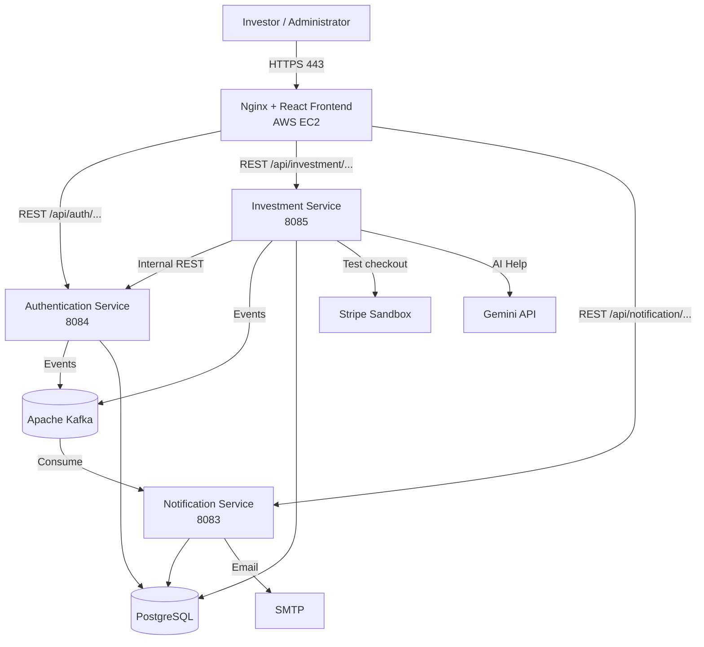
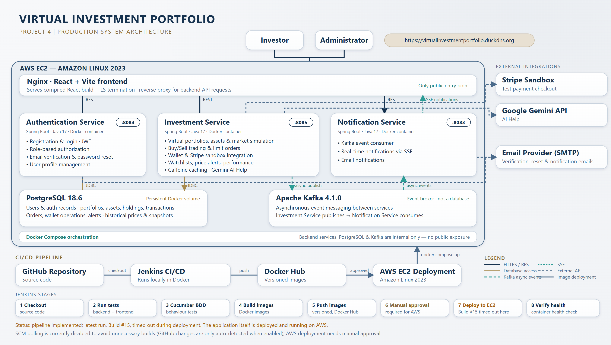
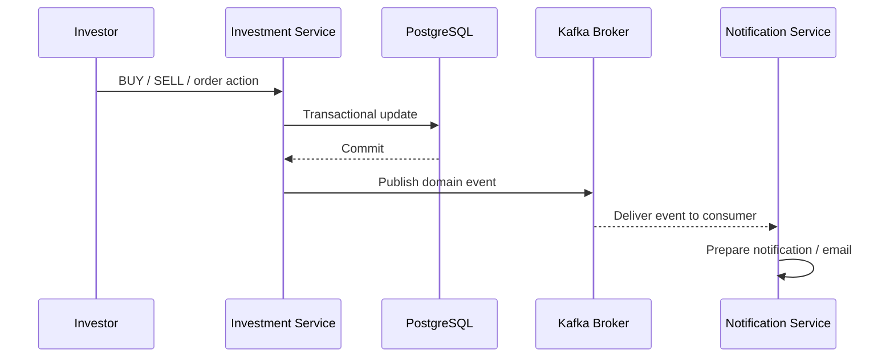
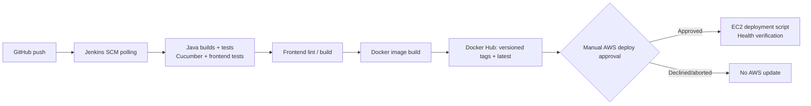

# Virtual Investment Portfolio System

**Project 4 — Productionized Backend Application**  
General Assembly Java Developer Bootcamp · Java 17 · Spring Boot · React · PostgreSQL · Kafka · Docker · Jenkins · AWS

[**Live application (HTTPS)**](https://virtualinvestmentportfolio.duckdns.org) · [**GitHub repository**](https://github.com/Shaikha-Projects/Virtual-Investment-Portfolio) · [**Project planning (Jira)**](https://investmentportfolio.atlassian.net/jira/software/projects/SCRUM/boards/1/backlog)

> **Educational simulation:** This project uses simulated asset prices and virtual portfolio balances. Stripe is configured in **test/sandbox mode**; it is not a real brokerage or an investment recommendation.

## Contents

1. [Overview and Project Evolution](#overview-and-project-evolution)
2. [Features](#features)
3. [Technology Stack](#technology-stack)
4. [Microservices Architecture](#microservices-architecture)
5. [Service Boundaries and Data Ownership](#service-boundaries-and-data-ownership)
6. [Apache Kafka and Event-Driven Communication](#apache-kafka-and-event-driven-communication)
7. [Database and ERD](#database-and-erd)
8. [Caching, Concurrency, and Reliability](#caching-concurrency-and-reliability)
9. [Docker and Local Setup](#docker-and-local-setup)
10. [CI/CD with Jenkins](#cicd-with-jenkins)
11. [AWS Architecture and Deployment](#aws-architecture-and-deployment)
12. [Configuration and Security](#configuration-and-security)
13. [Testing and Evidence](#testing-and-evidence)
14. [API Documentation](#api-documentation)
15. [Challenges, Limitations, and Future Work](#challenges-limitations-and-future-work)
16. [Planning and Deliverables](#planning-and-deliverables)
17. [Credits and Resources](#credits-and-resources)

## Overview and Project Evolution

Virtual Investment Portfolio is a full-stack application where investors register and verify their accounts, fund a **virtual** wallet through Stripe Sandbox, trade simulated assets, manage limit orders, and track holdings and portfolio performance. Administrators manage users, assets, and audit activity.

Project 4 continues the same application developed in Projects 2 and 3; it does **not** replace the existing investment workflows. The focus is on moving the application toward a deployable, distributed environment.

| Stage | Main work |
|---|---|
| **Project 2 — Core application** | Java/Spring Boot REST API, PostgreSQL, JWT authentication, account and trading workflows |
| **Project 3 — Concurrency** | Concurrent limit-order execution, scheduled market simulation, pessimistic database locking, asynchronous notifications, rate limiting, portfolio snapshots and charts |
| **Project 4 — Productionization** | Three independently runnable Spring Boot services, Kafka-based messaging, Docker/Compose, Caffeine caching, automated tests including Cucumber, Jenkins CI/CD, Docker Hub releases, and AWS EC2 deployment with an HTTPS gateway |

**Deployment status (November 17, 2026):** The Virtual Investment Portfolio is deployed on AWS EC2 and accessible through HTTPS. All six Docker containers were verified healthy. Jenkins successfully completed CI testing and published versioned Docker images to Docker Hub. During Build #15, Jenkins connected to AWS and deployed the Authentication and Investment Services using the new release images. However, the pipeline exceeded its deployment timeout before completing the full release. The application remained operational, with the Notification Service running its previously deployed version.
## Features

| Area | Functionality |
|---|---|
| **Accounts** | Registration, email verification, login, JWT-based authorization, password reset/change, user profiles, admin bootstrap |
| **Portfolio and trading** | Simulated assets, direct BUY/SELL, limit orders, available/reserved cash and shares, transaction/order history |
| **Wallet** | Stripe Sandbox deposit flow, virtual cash balance and withdrawal controls, operation history |
| **Market** | Simulated price updates approximately every 10 seconds; price-history charts and asset search |
| **Analytics** | Total portfolio value, cost basis, realized/unrealized P/L, historical snapshots, allocation and asset performance |
| **Investor tools** | Watchlists, price alerts, notifications, Gemini AI Help |
| **Administration** | User statuses/roles, asset management and audit records |
| **Security and resilience** | Spring Security, role checks, per-endpoint rate limiting, database transactions/locks, health checks, persistent volumes |

New investor portfolios start at **$0 virtual cash and $0 initial funding** and use Stripe Sandbox to add simulated funds. Historical portfolios retain their recorded funding and balances. No live stock-exchange prices are used.

## Technology Stack

| Layer | Technologies |
|---|---|
| Backend | Java 17, Spring Boot, Spring Web, Spring Security, Spring Data JPA / Hibernate, Maven |
| Services | Authentication Service, Investment Service, Notification Service |
| Frontend | React, Vite, JavaScript, CSS; production Nginx server |
| Database | PostgreSQL 18, persistent Docker volume |
| Messaging | Apache Kafka 4.1, producers/consumers, asynchronous service events |
| Cache | Caffeine for investment portfolio/snapshot-related reads |
| Payments and AI | Stripe **Sandbox**, Gemini API |
| Tests | JUnit, Mockito, service/integration tests, Cucumber BDD/REST-assured-style API scenarios, frontend tests, ESLint/build |
| Containers | Docker, Docker Compose, Docker Hub |
| CI/CD | Jenkins, Maven, Node.js, Docker Buildx, GitHub SCM polling, secure Jenkins credentials |
| Hosting | AWS EC2 (Amazon Linux 2023, `us-east-1`), EBS, VPC/security group, Nginx, Let's Encrypt, DuckDNS |
| Collaboration/docs | Git/GitHub, Jira, Swagger/OpenAPI, ERD |

## Microservices Architecture

Project 4 separates three business capabilities into independently deployable Spring Boot applications. The frontend reaches them through a single Nginx entry point; the services use internal Docker DNS names and Kafka where asynchronous communication is appropriate.



*Architecture diagram describes logical responsibilities and connectivity; exact REST paths/events are controlled by the implementation. The deployment runs these services within one EC2 instance, not across separate AWS instances.*

### Before and after

- **Before (Projects 2–3):** One Spring Boot backend containing accounts, investment logic and notifications, accompanied by a React frontend and PostgreSQL.
- **After (Project 4):** Three separate Spring Boot services with their own build files and Docker images; Kafka handles asynchronous events; Nginx fronts the containerized React/backend APIs; Jenkins publishes images for EC2 deployment.

### Production System Architecture

The application runs on AWS EC2 using Docker Compose,
with three Spring Boot microservices, React, Nginx,
PostgreSQL, and Apache Kafka.



## Service Boundaries and Data Ownership

| Service | Responsibility / owned behavior | Main communication | Container port |
|---|---|---|---|
| **Authentication** (`auth-service/`) | Register/authenticate users, email verification tokens, JWTs, roles, profile/user administration, service authentication | REST API; produces relevant events | `8084` |
| **Investment** (`investment-service/`) | Assets, prices, trading, holdings, wallets, portfolio analytics/snapshots, orders, watchlists and alerts, Stripe Sandbox, AI Help | REST API; internal Auth API; Kafka event publishing | `8085` |
| **Notification** (`notification-service/`) | Notification consumers, SMTP verification/reset/transaction emails, notification delivery | Kafka consumption; notification endpoints/SSE as implemented | `8083` |

Each service has its own Spring Boot runtime, dependencies, configuration and Dockerfile. Services communicate through explicit APIs or messaging rather than by importing each other's internal Java service classes.

**Current data-ownership limitation:** The deployed services share **one PostgreSQL database** (`investment_portfolio`) and rely on domain-level ownership of tables. This is simpler for this project, but it is not database-per-service isolation; cross-service schema coupling remains a tradeoff. A separate schema/database per service is a future improvement, not a feature claimed to be implemented.

## Apache Kafka and Event-Driven Communication

Kafka decouples investment/authentication activities from notification delivery. After business operations occur, a producer publishes an event; the Notification Service consumes it and handles follow-up work without requiring the originating HTTP request to send the email synchronously.



**Relevant events:** investment/trading and account-related events that drive notifications. For a submission-grade event contract, use the **actual topic constant, producer/consumer class, message fields, and retry/acknowledgment settings from the checked-in Java code** rather than inventing a topic name or JSON payload here.

| Event documentation item | Where to verify |
|---|---|
| Kafka topic name(s) | Producer/consumer `@KafkaListener` and topic configuration in the service source |
| Producer | Publishing code in Authentication or Investment Service |
| Consumer | Notification Service Kafka listener |
| Event fields | Actual event DTO/message class |
| Delivery/retry behavior | Listener acknowledgment, failure handling and any outbox logic in source |

**Reliability:** Investment records are committed in PostgreSQL independently of downstream email delivery. Message duplication, consumer outages, backpressure, and any retry/outbox assumptions should be evaluated against the actual listener implementation. A distributed event system should not be described as exactly-once simply because Kafka is present. An always-available durable notification inbox is not claimed.

## Database and ERD

The AWS environment uses PostgreSQL 18.6 with a persistent Docker volume; its data is separate from the original local Docker database. The investor's data was migrated with a verified backup and foreign-key checks while preserving the AWS administrator.

The current PostgreSQL schema includes **16 tables**, reflecting the expansion beyond the 12-entity Project 3 ERD:

`assets`, `audit_logs`, `auth_outbox`, `email_verification_tokens`, `holdings`, `investment_orders`, `investment_outbox`, `password_reset_tokens`, `portfolio_snapshots`, `portfolios`, `price_alert`, `price_history`, `transactions`, `users`, `wallet_operations`, `watchlist`.

Core relations:

- `users` → `portfolios` (one portfolio per user in the implemented schema).
- `portfolios` → `holdings`, `transactions`, `investment_orders`, `wallet_operations`, `portfolio_snapshots`, `price_alert`.
- `assets` → holdings, price history, investment orders, watchlists and price alerts.
- `users` → watchlist, verification and password-reset tokens.

**Project 4 ERD):** [View in dbdiagram.io](https://dbdiagram.io/d/Investment-Portfolio-6aba48670f25a52d0128e646).  

The repository contains `investment_schema.sql` and `assets_data.sql` for schema/seed reference. Never import historical schema scripts indiscriminately into a database that already has tables and user data.

## Caching, Concurrency, and Reliability

### Caching

The Investment Service uses **Caffeine** caching for portfolio/snapshot-related reads to reduce repeated database work. Cache behavior is local to the service instance, not a distributed cache. The source configuration is the authority for cache keys, eviction and expiration.

### Continued Project 3 concurrency features

- Scheduled simulated market price updates approximately every 10 seconds.
- Pending order execution using managed Spring thread pools.
- Database transactions and pessimistic locking for balances, holdings, orders and current asset prices.
- Reserved cash/shares, locked-price rechecks and order-status validation to reduce overspending, double execution and invalid fills.
- Async notifications and SSE where implemented, with bounded request rate limiting.
- Portfolio history recorded from periodic snapshots (not fabricated historical values).

### Runtime reliability

- Docker health checks gate service startup.
- Named volumes persist PostgreSQL and Kafka data across container recreation.
- PostgreSQL/Kafka are **not** exposed as public EC2 ports.
- AWS deployment updates backend services individually and checks readiness; data volumes are retained.
- `t3.small` has **2 GiB RAM plus a 2 GiB swap file**, so resource headroom is limited; swap is not a substitute for RAM.

## Docker and Local Setup

### Repository layout

```text
Virtual-Investment-Portfolio/
├── auth-service/                # Spring Boot authentication
├── investment-service/          # Spring Boot investment / trading
├── notification-service/        # Spring Boot notifications
├── frontend/                    # React + Vite
├── docker-compose.yml           # Local PostgreSQL, Kafka, service containers
├── Jenkinsfile                  # CI/CD pipeline
├── ci/jenkins/                  # Jenkins controller + EC2 deployment scripts
├── deploy/aws/                  # AWS Compose, Nginx, TLS, runbook
├── investment_schema.sql
├── assets_data.sql
└── README.md
```

### Prerequisites

- Git, Docker Desktop (with Docker Compose), a working `.env` configuration.
- Java 17, Maven and Node.js if running services and frontend outside Docker.
- Working Docker images for local Compose, or build them with the service Dockerfiles first.

### Local Docker deployment

```bash
git clone https://github.com/Shaikha-Projects/Virtual-Investment-Portfolio.git
cd Virtual-Investment-Portfolio
```

Create a **local `.env`** containing the variables required by the local Compose file and service properties; do **not** commit it. At minimum, the local Compose references `DB_PASSWORD` and `env_file: .env` for application settings. Common additional settings include JWT, service key, mail, Stripe Sandbox and Gemini keys.

The original local `docker-compose.yml` refers to locally built images, so create those images before starting if not already present. Example:

```bash
docker build -t investment-auth:local ./auth-service
docker build -t investment-service:local ./investment-service
docker build -t investment-notification:local ./notification-service
docker compose up -d
docker compose ps
```

The exact Dockerfiles/build contexts determine whether packaged JARs must be prepared first. The CI pipeline handles Maven packaging and builds versioned release images automatically.

Local backend ports: Auth `8084`, Investment `8085`, Notification `8083`; PostgreSQL host port `5433` and Kafka host port `9092` are for local development only. Start the React development server separately:

```bash
cd frontend
npm ci
npm run dev
```

Open `http://localhost:5173` for development. **Never use `docker compose down -v` casually:** it destroys the named database/broker volumes.

## CI/CD with Jenkins

The local Jenkins controller is itself containerized (`jenkins-local`) with the persistent `jenkinsvol1` volume. Jenkins runs locally inside Docker with a persistent volume. During development, SCM polling checked GitHub every five minutes to automatically trigger builds when code changed. SCM polling has since been disabled to prevent unnecessary builds. The pipeline remains available for manual execution through Jenkins.



### Pipeline stages

1. Checkout `main` from GitHub.
2. Run Maven `clean verify` for Authentication, Investment (including Cucumber), and Notification services.
3. Run frontend `npm ci`, automated tests, ESLint, and production Vite build.
4. Build three Docker images and publish them to Docker Hub **only after CI passes**.
5. Publish both immutable `build-N-<commit>` tags and `latest`; archive a delivery manifest with image digests.
6. The AWS deployment stage requests manual approval before connecting securely to EC2. The deployment script updates Docker services and performs health checks. Build #15 successfully updated the Authentication and Investment Services, but Jenkins exceeded its deployment timeout before completing the full release. The end-to-end deployment stage therefore remains partially verified.

### Docker Hub images

- [`shaikhahsn/investment-auth`](https://hub.docker.com/r/shaikhahsn/investment-auth)
- [`shaikhahsn/investment-service`](https://hub.docker.com/r/shaikhahsn/investment-service)
- [`shaikhahsn/investment-notification`](https://hub.docker.com/r/shaikhahsn/investment-notification)

**Verified evidence:** Jenkins Build **#11** completed the full CI and three-image publish with six remote-tag verifications. Build **#13** passed and published updated Notification Service code. Build **#14** passed CI and published images but was aborted before live deployment. Build **#15** was automatically triggered by commit `110f541`; its AWS deployment outcome remains to be recorded.

### Jenkins credentials and safety

| Jenkins credential ID | Usage |
|---|---|
| `dockerhub-credentials` | Docker Hub username / access token for image pushes |
| `aws-ec2-ssh` | EC2 deploy access via `ec2-user` private key |
| `aws-ec2-known-hosts` | Verified SSH host-key entry |

All secrets stay in Jenkins credentials, never in `Jenkinsfile` or Git. The local Jenkins controller has Docker socket access, which grants powerful Docker-host privileges; allow only trusted code and do not expose Jenkins publicly. The AWS deployment script must preserve persistent data and allow rollback to a previously published version.

## AWS Architecture and Deployment

### Actual AWS environment

| Component | Configuration |
|---|---|
| Cloud | AWS EC2, **US East (N. Virginia)** `us-east-1` |
| Host OS | Amazon Linux 2023 |
| Instance | `t3.small` (2 vCPU, 2 GiB RAM), 2 GiB swap |
| Storage | 30 GiB `gp3` EBS root volume + named Docker volumes |
| Web entry | Nginx/React container serving ports 80 and 443 |
| TLS | Let's Encrypt certificate for DuckDNS hostname |
| Database | PostgreSQL 18.6 container, internal-only |
| Broker | Kafka 4.1 container, internal-only |
| Services | Auth `8084`, Investment `8085`, Notification `8083`, internally routed |
| Public site | **https://virtualinvestmentportfolio.duckdns.org** |

Only the web gateway is exposed publicly. SSH access is restricted using the EC2 security group and authorized SSH keys. The EC2 public IP/DuckDNS mapping may change when an instance is stopped and restarted unless a stable addressing strategy is used.

### Deployment configuration

- `deploy/aws/compose.yml` — persistent services, resource controls, health checks and HTTP gateway.
- `deploy/aws/tls.yml` — HTTPS overlay for Nginx.
- `deploy/aws/frontend.Dockerfile` — static production frontend image.
- `deploy/aws/nginx/` — same-origin API proxy rules, SSE forwarding, wallet route fallback and TLS gateway templates.
- `deploy/aws/.env.example` — required variable names, **not** real credentials.
- [`deploy/aws/README.md`](deploy/aws/README.md) — **authoritative step-by-step deployment, certificate and rollback runbook**.

### Typical EC2 deployment sequence

The live server is already provisioned; these are the reproducible operational steps for an authorized EC2 operator, not an instruction to reset a working database:

```bash
cd /home/ec2-user/Virtual-Investment-Portfolio
git pull --ff-only

# deploy/aws/.env must already exist securely on EC2.
docker compose --env-file deploy/aws/.env \
  -f deploy/aws/compose.yml -f deploy/aws/tls.yml config --quiet

docker compose --env-file deploy/aws/.env \
  -f deploy/aws/compose.yml -f deploy/aws/tls.yml pull

docker compose --env-file deploy/aws/.env \
  -f deploy/aws/compose.yml -f deploy/aws/tls.yml up -d

docker compose --env-file deploy/aws/.env \
  -f deploy/aws/compose.yml -f deploy/aws/tls.yml ps
```

The frontend is built locally on EC2 for initial provisioning if `investment-frontend:aws` does not exist (see `deploy/aws/README.md`). For new releases, the prepared CD script reuses unchanged frontend assets or ships the Jenkins-built frontend artifact when it changes. PostgreSQL and Kafka volumes must **not** be removed during updates.

### HTTPS

A DuckDNS hostname points to the EC2 public address. A Let's Encrypt certificate was issued successfully; Nginx serves the site over HTTPS. **Certificate expiry: February 15, 2027.** Renewal is **not yet automated** and must be arranged before expiration (the AWS runbook documents the manual procedure). Do not use HTTP to transmit passwords or real account data.

### AWS verification already completed

- Six Docker containers reported healthy: PostgreSQL, Kafka, Auth, Investment, Notification and frontend.
- Public HTTPS frontend opened successfully.
- Existing Admin and Investor accounts authenticated on AWS.
- Investor account data was migrated safely: 1 portfolio, 3 holdings, 5 transactions, 1 order, 1 wallet operation, 1 watchlist entry, 1 alert, 172 snapshots, 6 audit records and 15,193 price-history records; AWS admin remained intact.
- Stripe Sandbox **Deposit navigation** opened after correcting the Investment Service return URLs to the HTTPS origin. A completed sandbox payment was **not** independently confirmed.
- Notification Service deployment was updated to generate public HTTPS verification/reset links; actual SMTP arrival/verification still requires manual confirmation.

## Configuration and Security

Real credentials are stored in ignored files on the relevant environment, not in GitHub:

| Variable | Purpose |
|---|---|
| `PUBLIC_HOST` | Public hostname, no protocol |
| `PUBLIC_ORIGIN` | HTTPS origin, e.g. `https://virtualinvestmentportfolio.duckdns.org` |
| `IMAGE_TAG` | Immutable Docker release tag selected for deployment |
| `DB_PASSWORD` | PostgreSQL password |
| `JWT_SECRET` | Shared JWT signing secret configured consistently across relevant services |
| `INTERNAL_SERVICE_KEY` | Internal service authentication key |
| `MAIL_USERNAME`, `MAIL_PASSWORD` | SMTP identity / app password |
| `STRIPE_SECRET_KEY` | **Sandbox** Stripe secret key |
| `GEMINI_API_KEY` | Gemini Developer API key |
| `ADMIN_EMAIL`, `ADMIN_PASSWORD` | Optional initial administrator bootstrap (remove the bootstrap password after setup when practical) |

Do not commit `.env`, `.pem` files, TLS private keys, database dumps, profile uploads, Jenkins credentials or API tokens. Backend containers listen on the private Docker network; Nginx is the public gateway. Email verification/reset links use the deployment's `PUBLIC_ORIGIN`. External integrations should be tested with sandbox/test accounts.

## Testing and Evidence

| Evidence | Verified result |
|---|---|
| Jenkins Build #11 | Full CI passed; three service images published with versioned and `latest` tags; remote tags/digests verified |
| Jenkins Build #13 | Notification update, **44 Notification tests** passed, image published |
| Jenkins Build #14 | **602 tests passed**, nine opt-in tests skipped; frontend lint/build passed; images published; deployment **not** approved |
| Cucumber | All **five** API scenarios passed in the reported CI runs |
| Frontend | **85** tests reported passing in the prior successful CI run; lint and production build passed |
| AWS runtime | Six containers healthy; HTTPS frontend and Admin/Investor login verified |
| Investor migration | Rehearsal and import checks passed; AWS backup created before migration; existing Admin preserved |
| Docker Compose | Production Compose validated; gateway/Nginx checks validated during deployment preparation |
| Jenkins Build #15 | CI and Docker image publishing completed; AWS deployment approved; Authentication and Investment Services updated and verified healthy; pipeline ended ABORTED due to timeout |

Run relevant tests locally:

```bash
cd auth-service && mvn -B clean verify
cd ../investment-service && mvn -B clean verify
cd ../notification-service && mvn -B clean verify
cd ../frontend && npm ci && npm test && npm run lint && npm run build
```

Project-level Cucumber scenarios live in the Investment Service and run as part of its Maven verification. The opt-in database/external-service tests skipped in CI should not be counted as passed tests. Always report build number, commit, and run status when presenting test evidence.

**Suggested submission screenshots:** successful Jenkins pipeline/stages, Docker Hub versioned image tags, Compose running containers, EC2 instance/security-group overview (hide account identifiers where possible), HTTPS login, investor dashboard, Kafka event demonstration, and Swagger/OpenAPI endpoints. Screenshots are evidence, not substitutes for configuration/source files.

## API Documentation

The project uses Swagger/OpenAPI for REST API discovery. Because Project 4 has **three separate Spring Boot services**, check each service's Swagger/OpenAPI configuration rather than assuming the Project 3 monolith's `localhost:8081` documentation URL still applies.

Local service ports:

- Authentication: `http://localhost:8084`
- Investment: `http://localhost:8085`
- Notification: `http://localhost:8083`

Typical Springdoc paths, **if enabled in each service**, are `/swagger-ui/index.html` and `/v3/api-docs`. For protected endpoints, supply the appropriate Bearer token. Swagger endpoints may intentionally be restricted behind the public Nginx gateway; don't expose documentation or internal endpoints publicly just for a demo.

Project 4 also maintains a separate asset API artifact, `asset-api.html`/JSON, where included as a Jenkins artifact. Document Kafka topics and payloads alongside API contracts (not as REST routes).

## Challenges, Limitations, and Future Work

### Challenges addressed

1. **Microservice separation:** keeping authentication, investment operations and notification workflows coherent while separating applications and deployments.
2. **Kafka and container networking:** using Docker service hostnames and fixing Kafka data-volume ownership when AWS Kafka initially failed with `AccessDeniedException`.
4. **Jenkins Docker access:** building inside a containerized controller, preserving `jenkinsvol1`, securely publishing images and handling a transient Docker Hub broken-pipe upload with bounded retries.
5. **AWS resources:** deploying six containers within `t3.small` memory limits, enabling swap, monitoring health, and preserving volumes.
6. **Public configuration:** establishing DNS/Let's Encrypt HTTPS, correcting notification localhost links and Stripe Sandbox return URLs.
7. **Data migration:** transferring a single investor with related records while preserving the AWS administrator and database relationships.

### Known limitations / unfinished verification

- **Email:** Public verification/reset URLs are configured; real email delivery and full registration/reset flows should be confirmed manually.
- **Stripe:** Sandbox Deposit page navigation works; full checkout callback and credited wallet balance still require a test payment verification.
- **Capacity:** Single `t3.small` host, 2 GiB physical RAM; not high-availability production hosting. Swap can introduce severe performance penalties.
- **Storage/ownership:** Services share one PostgreSQL database; not independently scalable data stores.
- **Simulated finance:** No live exchange feed or real-money trading.

### Future improvements

- Real-Time Market Data: Integrate a stock market API to replace simulated prices with real market data while keeping trading virtual.
- Advanced Portfolio Analytics: Add more detailed performance reports, investment comparisons, and risk analysis to help investors evaluate their portfolios.
- Enhanced AI Help: Expand the AI assistant to explain investment concepts, portfolio performance, and financial terminology.
- Improved Notifications: Add more notification preferences so investors can choose which alerts they receive and how they receive them.
- Mobile Application: Develop a mobile version of the platform to make virtual investment management more accessible.

## Planning and Deliverables

Project 4 followed the project rubric's progression: retain the application → separate services → containerize with Compose → add Kafka and caching → build CI/CD → publish Docker images → deploy to AWS → document and demonstrate.

- [GitHub source repository](https://github.com/Shaikha-Projects/Virtual-Investment-Portfolio)
- [Jira board / user stories](https://investmentportfolio.atlassian.net/jira/software/projects/SCRUM/boards/1/backlog)
- Architecture diagram: Mermaid above; export a finalized image if required by the submission tracker.
- ERD: existing [dbdiagram](https://dbdiagram.io/d/Investment-Portfolio-6aba48670f25a52d0128e646) needs Project 4 refresh for all 16 tables.
- Docker artifacts: service Dockerfiles, local `docker-compose.yml`, `deploy/aws/compose.yml`, `deploy/aws/tls.yml`.
- CI/CD configuration: `Jenkinsfile`, `ci/jenkins/`.
- AWS deployment instructions: `deploy/aws/README.md`.
- API documentation: service Swagger/OpenAPI and generated API artifacts where enabled.

## Credits and Resources

Developed for the **General Assembly Java Developer Bootcamp**, extending the same application through Projects 2–4. The instructor's guidance,a and documentation were used during development

| Resource | URL | How it was used |
|---|---|---|
| Spring Boot | https://docs.spring.io/spring-boot/ | Independent backend applications, configuration and health |
| Spring Security | https://docs.spring.io/spring-security/reference/ | Authentication, JWT and role protection |
| Spring Data JPA | https://docs.spring.io/spring-data/jpa/reference/ | Database persistence and transaction handling |
| PostgreSQL | https://www.postgresql.org/docs/ | Relational schema, backup, data migration |
| React | https://react.dev/ | Investor/admin interface |
| Vite | https://vite.dev/ | Frontend development and production build |
| Apache Kafka | https://kafka.apache.org/documentation/ | Event publishing/consumption |
| Docker | https://docs.docker.com/ | Service image builds and container runtime |
| Docker Compose | https://docs.docker.com/compose/ | Local/AWS orchestration and health dependencies |
| Jenkins | https://www.jenkins.io/doc/ | CI/CD, secure credentials and pipeline |
| Cucumber | https://cucumber.io/docs/ | Behavior-driven API scenarios |
| AWS EC2 | https://docs.aws.amazon.com/ec2/ | Cloud instance, SSH and security-group setup |
| Let's Encrypt | https://letsencrypt.org/docs/ | HTTPS certificate issuance |
| Certbot | https://eff-certbot.readthedocs.io/ | Certificate acquisition and renewal procedure |
| Stripe Docs | https://docs.stripe.com/ | Sandbox checkout and wallet return URLs |
| Gemini API | https://ai.google.dev/gemini-api/docs | AI Help integration |
| OpenAI / Codex | https://openai.com/codex/ | Assisted with code review, CI/CD scripts, debugging and deployment preparation |

---
